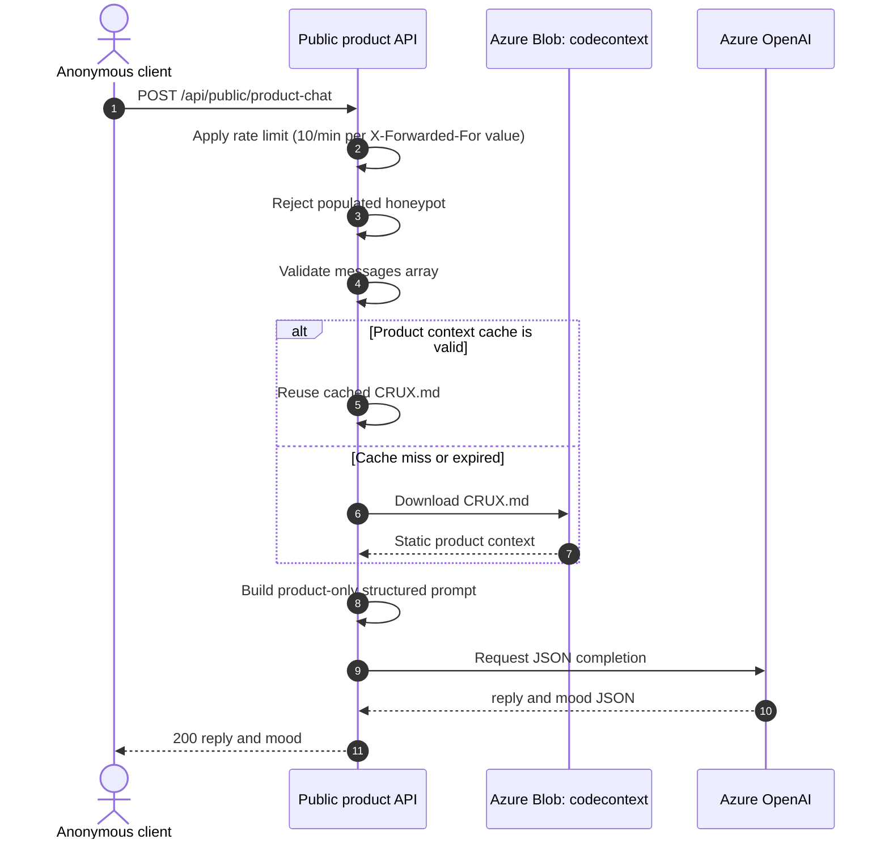

# OneHook UX Enhancement: Mr OneHook backend and infrastructure

This repository is the backend of **Mr OneHook**, the OneHook chat assistant. It is a Node.js/Express
service (`backend/`) on **Azure App Service** that answers with an **Azure OpenAI** chat deployment
(Terraform deploys `gpt-4o` model version `2024-11-20`; the backend calls it with API version
`2024-02-15-preview` and JSON response format). Infrastructure is **Terraform** (`infra/`), deployed per
stage (gamma, prod) by **GitHub Actions** that log in to Azure with OIDC, so no deployment keys are stored.

The service's HTTP API is modelled in Smithy as `MrOneHookService` in this repo,
`sdk/model/mr-onehook.smithy`, and published as the npm package **`onehook-mr-onehook-client`** (see
[The Mr OneHook SDK](#the-mr-onehook-sdk-onehook-mr-onehook-client)). To reach OneHook data in AWS, the App
Service's managed identity is federated into the AWS role `OneHook-MrOneHook-<stage>-Role` (see
[AWS federation](#aws-federation-and-outbound-calls)).

---

## Architecture

```mermaid
flowchart LR
  subgraph Clients["Client devices"]
    Anonymous["Anonymous client"]
    MemberApp["Signed-in iOS, Android, or client app"]
    LocalMessages[("End-to-end encrypted match messages<br/>decrypted only on the user device")]
    LocalSearch["Search recent and relevant<br/>messages locally"]
    Confirm["Optional user confirmation<br/>for selected excerpts"]
  end

  subgraph AWS["Amazon Web Services · AWS"]
    Cognito["Amazon Cognito<br/>ID token JWKS + custom:subscriptionTier"]
    UxQueue[("SQS OneHook-Matching-&lt;stage&gt;-UxErasure<br/>UserDeleted from Profile")]
  end

  subgraph OneHookPlatform["OneHook platform services"]
    OneHookData["State: AI-visible match/profile policy<br/>GET /api/ai-context/matches/:matchId"]
    MatchingStatus["State: member matching mode<br/>GET /state/internal/users/:userId/matching"]
    Suggestions["Matching: record suggestion<br/>POST /matching/internal/suggestions"]
  end

  subgraph Azure["Microsoft Azure"]
    subgraph UX["OneHook UX Enhancement package · Azure App Service"]
      PublicRoute["POST /api/public/product-chat"]
      MemberRoute["POST /api/member/product-connection-chat"]
      UserAuth["Verify Cognito ID token<br/>issuer · audience · JWKS<br/>20 requests/min per member"]
      MatchGate{"matchId supplied?"}
      MatchAuth["Authorize active match<br/>and AI-visible profile policy"]
      ValidateExcerpts["Validate bounded ephemeral excerpts<br/>Never persist or log them"]
      FreeQuota["Must tier only: take 1 of<br/>10 daily messages"]
      SessionGate{"sessionOptions.persist?"}
      TierPolicy["Resolve verified Cognito tier<br/>and enforce session policy"]
      SessionStore["Load or save user-scoped<br/>application-readable AI session"]
      Assemble["Assemble minimized untrusted prompt<br/>product + profile + ephemeral excerpts + AI session"]
      ContextDecision{"More local context needed?"}
      ContextRequest["Return bounded search terms<br/>date range + max messages"]
      PublicResult["Product reply + mood"]
      MemberResult["Member reply + mood<br/>contextUsed + optional session metadata"]
      SuggestionGate{"Product chat with matchSuggestion<br/>and member matching ON?"}
      ErasureWorker["Account erasure worker<br/>long-polls UserDeleted"]
    end

    subgraph AzureServices["Azure managed services"]
      ProductBlob[("Private codecontext container<br/>CRUX.md")]
      SessionBlob[("Private aisessions container<br/>AI turns + hashed session index")]
      QuotaTable[("Table chatquota<br/>free-tier daily counters")]
      OpenAI["Azure OpenAI<br/>structured completion"]
    end
  end

  Anonymous --> PublicRoute
  ProductBlob --> PublicRoute
  PublicRoute <-->|"Structured completion"| OpenAI
  PublicRoute --> PublicResult --> Anonymous

  MemberApp --> MemberRoute --> UserAuth
  Cognito -->|"Validate token and verified tier claim"| UserAuth
  UserAuth --> MatchGate
  MatchGate -->|"No · product only"| FreeQuota
  MatchGate -->|"Yes · connection context"| MatchAuth
  MatchAuth <-->|"SigV4: authorize match and profiles"| OneHookData
  MatchAuth --> ValidateExcerpts --> FreeQuota
  FreeQuota <-->|"ETag-conditional counter"| QuotaTable
  FreeQuota --> Assemble
  ProductBlob --> Assemble

  LocalMessages --> LocalSearch --> Confirm
  Confirm -->|"Memory-only ephemeralMessageContext"| MemberRoute
  ContextRequest --> MemberApp
  MemberApp -->|"Local search and retry"| LocalSearch

  UserAuth --> SessionGate
  SessionGate -->|"Yes"| TierPolicy --> SessionStore
  SessionStore <-->|"Plaintext at application layer<br/>Azure platform encryption still applies"| SessionBlob
  SessionStore -->|"Bounded prior AI turns"| Assemble

  Assemble <-->|"Structured completion"| OpenAI
  Assemble --> ContextDecision
  ContextDecision -->|"Yes"| ContextRequest
  ContextDecision -->|"No"| MemberResult --> MemberApp
  MemberResult -->|"Persist completed AI exchange when requested"| SessionStore
  MemberResult --> SuggestionGate
  SuggestionGate <-->|"SigV4: read status first (fail closed)"| MatchingStatus
  SuggestionGate -->|"SigV4 + member ID token, only when ON"| Suggestions

  UxQueue -->|"SigV4, federated role"| ErasureWorker
  ErasureWorker -->|"Delete the member's sessions + session index"| SessionBlob
  ErasureWorker -->|"Delete the member's counter rows"| QuotaTable
  ErasureWorker -->|"Delete the message only after both"| UxQueue

  style AWS fill:#fff7e6,stroke:#ff9900,stroke-width:2px
  style OneHookPlatform fill:#f7f3ff,stroke:#6f42c1,stroke-width:2px
  style Azure fill:#eef6ff,stroke:#0078d4,stroke-width:2px
```



The anonymous route answers product questions only. The member route always receives product context; `matchId` adds freshly authorized profile/match policy, and the app may attach a bounded `ephemeralMessageContext` selected after local decryption. UX Enhancement uses those excerpts only in memory for the current model request and never mirrors match messages in Azure. Separately, members whose tier has a session policy (Super and Infinity by default) may opt into application-readable Mr OneHook AI sessions stored in a private Azure container; Azure platform encryption at rest still applies.

### How to read the arrows

The architecture flowchart shows **which components may communicate**; its arrows are dependency/data-flow links, not a single execution timeline. For exact runtime order, use the auto-numbered sequences below: `alt` means one mutually exclusive path, `opt` means a conditional step, and `loop` means the client may retry after a local search.

#### Public product chat sequence



#### Authenticated member and local-context retry sequence

```mermaid
sequenceDiagram
  autonumber
  actor User
  participant App as iOS / Android / client app
  participant Local as Local encrypted message store
  participant MemberAPI as Member product/connection API
  participant Cognito as Amazon Cognito
  participant OneHookData as OneHook match/profile API
  participant ProductBlob as Azure Blob: codecontext
  participant SessionBlob as Azure Blob: aisessions
  participant AOAI as Azure OpenAI

  User->>App: Ask Mr OneHook a question
  opt App can identify useful context before the first request
    App->>Local: Search recent/relevant messages locally
    Local-->>App: Decrypted bounded excerpts
    App->>User: Optional confirmation of selected excerpts
  end
  App->>MemberAPI: POST question, matchId and optional ephemeralMessageContext
  opt JWKS cache miss or signing-key rotation
    MemberAPI->>Cognito: Fetch signing keys
    Cognito-->>MemberAPI: JWKS
  end
  MemberAPI->>MemberAPI: Verify ID token signature, issuer, audience, expiry and subject; read tier claim
  MemberAPI->>MemberAPI: Apply per-member rate limit and validate request budgets
  opt matchId supplied
    MemberAPI->>OneHookData: SigV4 GET /api/ai-context/matches/{matchId}
    OneHookData-->>MemberAPI: Authorized projection and messageHistoryAllowed
  end
  opt Existing sessionId supplied
    MemberAPI->>SessionBlob: Load user-scoped application-readable AI session
    SessionBlob-->>MemberAPI: Bounded prior AI turns
    MemberAPI->>MemberAPI: Verify user and product/match scope binding
  end
  opt Must tier (free)
    MemberAPI->>MemberAPI: Take one of today's 10 messages (Table chatquota); 402 when none are left
  end
  alt Product context cache is valid
    MemberAPI->>MemberAPI: Reuse cached CRUX.md
  else Cache miss or expired
    MemberAPI->>ProductBlob: Download CRUX.md
    ProductBlob-->>MemberAPI: Static product context
  end
  MemberAPI->>MemberAPI: Validate and use excerpts only in memory
  MemberAPI->>AOAI: Send minimized prompt and request structured completion
  AOAI-->>MemberAPI: Reply or bounded contextRequest
  alt More message context is required
    MemberAPI-->>App: needsMoreContext + requestId + search terms/date range/max messages
    App->>Local: Search locally using bounded contextRequest
    Local-->>App: Selected excerpts
    App->>User: Optional confirmation
    App->>MemberAPI: Retry with contextRequestId and ephemeral excerpts
    Note over App,MemberAPI: Authentication, authorization, validation and model steps repeat
  else Final answer is ready
    opt Session persistence requested and current tier is eligible
      MemberAPI->>SessionBlob: ETag-conditional writes: session index, then plaintext AI session
      SessionBlob-->>MemberAPI: Conditional writes accepted
    end
    MemberAPI-->>App: reply, mood, contextUsed and optional session metadata
  end
```

A product-only member request omits `matchId` and can never request match-message excerpts. A connection request verifies the match and `messageHistoryAllowed` before using app-supplied excerpts. Excerpts are treated as untrusted conversational data, not authorization evidence, and are not written to session storage, logs, or Blob Storage.

#### Session lifecycle order

All session paths first verify the member's Cognito ID token and the per-member rate limit. There is no group, scope or permission gate: every signed-in member may chat.

1. **List sessions:** enumerate only `sessions/<hash(user)>/`, reject cross-user bindings, lazily remove expired records, and return non-content metadata with `scope: product | connection` instead of raw match IDs.
2. **Read a session:** require a currently eligible Cognito tier (otherwise `403 CHAT_SESSION_NOT_INCLUDED_IN_TIER`), load only the user-scoped application-readable session, verify user and scope bindings, freshly reauthorize the match only for a connection-scoped session, apply the current tier's message cap, then return bounded AI turns.
3. **Delete a session:** validate the user-scoped session ID, delete its private Blob record, remove it from the hashed session index, then return `204` (also for a UUID that does not exist). Deletion remains available after a tier downgrade.
4. **Account deletion:** on the member's `UserDeleted` event, the erasure worker deletes every blob under `sessions/<hash(user)>/`, the `session-quotas/<hash(user)>.json` session index and the member's `chatquota` rows (see [Account deletion](#account-deletion-userdeleted)).

Match-to-match messages never enter this lifecycle. They stay in the app's end-to-end encrypted local store and are shared only as bounded, temporary excerpts for a specific request.

### What Terraform Provisions

All of it is in `infra/main.tf`, one copy per stage (region `southindia` by default).

| Resource | Purpose |
|---|---|
| Resource group | `onehook-chatbot-rg` (gamma) or `onehook-chatbot-prod-rg` (prod) |
| App Service plan, Linux `B1` | Hosts the backend |
| Linux web app, Node `20-lts`, system-assigned identity | Runs `npm start`; HTTPS only, TLS 1.2 minimum, health check `/health` (eviction after 5 minutes); app settings listed under [Environment variables](#environment-variables) |
| Azure OpenAI account (`S0`, local key auth disabled) | Only Entra ID tokens can call it |
| Model deployment `gpt-4o` (`gpt-4o`, version `2024-11-20`, `Standard`, capacity 10) | Chat completions for both routes |
| Storage account (`<storage_account_name><6 random chars>`, Standard LRS) | TLS 1.2 minimum, public nested items disabled, shared-key authentication disabled |
| Private `codecontext` container | `CRUX.md`, the static product context |
| Private `aisessions` container | Application-readable Mr OneHook AI turns (`sessions/`) and hashed per-member session index (`session-quotas/`); Azure platform encryption still applies |
| Table `chatquota` (created through ARM with `azapi`) | Free-tier daily message counters |
| Storage lifecycle policy | Deletes `sessions/` and `session-quotas/` blobs not modified for `chat_session_max_retention_days` (90) days |
| Role assignments | App identity: Cognitive Services OpenAI User (OpenAI account), Storage Blob Data Reader (`codecontext`), Storage Blob Data Contributor (`aisessions`), Storage Table Data Contributor (`chatquota`). Deployer principal: Storage Blob Data Contributor on the account |
| Entra app registration `aws_audience` (when `aws_federation_enabled`) | The audience of the managed-identity token that AWS trusts |
| Custom hostname binding, App Service managed certificate, SNI binding (when `custom_domain_enabled`) | `chatbot.gamma.onehook.club` / `chatbot.onehook.club` |

Terraform outputs: `app_service_default_hostname`, `app_service_name`, `storage_account_name`,
`openai_endpoint`, `session_storage_container_name`, `stage`, `custom_domain`,
`custom_domain_verification_id` (sensitive), `chatbot_url` and `aws_federation`.

### Secrets and cost controls

- **No secrets in app settings.** The app reaches Azure OpenAI, Blob and Table Storage with its managed
  identity (`DefaultAzureCredential`); OpenAI key auth and storage shared keys are disabled. AWS credentials
  are short-lived STS credentials obtained at runtime. GitHub holds only the deploy identity's
  `AZURE_CLIENT_ID`, `AZURE_TENANT_ID` and `AZURE_SUBSCRIPTION_ID`.
- **Cost limits in code and infrastructure:** the model deployment's capacity is 10; public chat allows
  10 requests per minute per `X-Forwarded-For` value; member routes allow 20 requests per minute per member
  (in memory, per instance); free members get 10 messages per UTC day; JSON bodies are capped at 32 KB;
  `CRUX.md` is cached for 10 minutes; the App Service plan is `B1`. There is no Application Insights or
  budget alert in Terraform.

---

## Who can chat: free tier quota

Every signed-in member can chat with Mr OneHook; there is no group, scope or `context.chat` gate, and no
route answers `403` for chat access (`403` is only used for session-tier and excerpt-policy refusals).

- **Must** (free, including a missing or unknown tier claim): **10 messages per UTC day**
  (`FREE_DAILY_MESSAGES` in `backend/src/chatQuota.ts`). Beyond that the route returns
  `402 {"error": "MESSAGE_LIMIT_REACHED", "remainingMessages": 0}` and the model is not called. Successful
  responses for free members carry `remainingMessages` so the apps can show "3 left today".
- **Super and Infinity** (`PAID_SUBSCRIPTION_TIERS` from `onehook-api-client/membership`): unlimited,
  still subject to the 20 requests/minute per-member limit.
- The tier is the verified token's `AUTH_TIER_CLAIM` (default `custom:subscriptionTier`), never the
  client's; an upgrade applies at the next token refresh. Tier names are parsed by `onehook-api-client`
  (pinned `1.0.33`), which owns them.

**Storage:** Azure Table Storage table `chatquota` in the existing storage account (Terraform, created through ARM with `azapi` because the account has shared keys disabled), one row
per member (`PartitionKey` = sha256 of the member id, `RowKey` = `daily`) holding `{ day, count }`, overwritten
when the UTC day changes, so rows never grow and need no cleanup (a deleted account's rows are removed by
the [account erasure worker](#account-deletion-userdeleted)). Increments are read-then-ETag-conditional
writes (insert-if-absent for the first), retried on conflict, so concurrent messages cannot exceed the
limit. The slot is taken after request validation, match authorization and session checks, just before
the model call, and released if anything after it fails. A `needsMoreContext` answer also uses a message. The app reaches the table with
its managed identity and a **Storage Table Data Contributor** role scoped to that one table. If the store
is unavailable, free members get `503 CHAT_TEMPORARILY_UNAVAILABLE` (never unlimited); paid members are
unaffected. The rows hold no message content.

## Mr OneHook "find me ..." suggestions

When a member asks Mr OneHook to find a kind of person, the model adds an optional `matchSuggestion`
(`prompt`: a third-person description of who they want, with no physical or sensitive traits;
`reasoning`: one sentence for the member). The backend records it with
`POST {ONEHOOK_MATCHING_API_URL}/matching/internal/suggestions`, which needs two proofs:

- **Service:** SigV4 with this service's federated AWS role, `OneHook-MrOneHook-<stage>-Role`. OneHookBackend
  CDK creates the role (Matching stack); the IAM OIDC provider for the Entra tenant comes from the
  OneHook-Pipeline stack. The role trusts only this App Service's managed identity for the audience app
  registration below. It may invoke only the AI-context, matching-status and suggestion routes, and consume
  the account-erasure queue (see [AWS federation](#aws-federation-and-outbound-calls)).
- **Member:** the member's own Cognito ID token in `X-OneHook-Member-Token`, inside the signed headers.
  Matching verifies it and takes the member id and tier only from it, so this service can only act for a
  member who is in a live session with it.

**Matching must be ON (chat-only profiles).** A suggestion is matching data about one member: the one whose
token it carries. Before sending it, the backend reads that member's matching mode from State,
`GET {ONEHOOK_DATA_API_URL}/state/internal/users/{userId}/matching` (SigV4, same State API and signer as the
AI-context route; `userId` is the verified token subject). State answers
`{userId, status: OFF | ON | ERASING, generation}`, and an unknown member reads as `OFF`. The suggestion is
sent only for `ON`. `OFF` and `ERASING` give `MATCHING_OFF` and nothing is sent. If the status read fails
(signing, network, non-200, a body for another member or with an unknown status), nothing is sent and the
status is `UNAVAILABLE` (fail closed). Matching's own `403 MATCHING_OFF` (an opt-out racing the read) also
maps to `MATCHING_OFF`.

A member has one such suggestion; a new request replaces it, and the member can remove it in their
preferences. Suggestions are recorded **only from product chats** (no `matchId`): in a connection chat the
model also sees the other person's messages, which must never plant suggestions in this member's feed.

The chat response includes `matchSuggestion: { status, reasoning }` (`RECORDED`, `PREMIUM_REQUIRED`,
`MATCHING_OFF`, `UNAVAILABLE`). `PREMIUM_REQUIRED` and `MATCHING_OFF` come from the `code` field of
Matching's `403` body; any other failure, and a deployment without `ONEHOOK_MATCHING_API_URL`, gives
`UNAVAILABLE`. A suggestion is dropped when the model also asks for more context, and an unusable one
(prompt under 3 characters, or no reasoning) is dropped silently; the prompt is trimmed to 1000 characters
and the reasoning to 280. The prompt is never returned, logged or stored here. gamma sets
`onehook_matching_api_url`; prod leaves it empty.

**Federation is code.** The Entra app registration whose identifier URI is the AWS audience is managed by
Terraform here (`azuread_application_registration.aws_audience`, v1 tokens because the AWS provider
trusts the `sts.windows.net` issuer); gamma's pre-existing registration is adopted by an `import` block.
`terraform output aws_federation` gives the tenant, audience and managed-identity principal id that
OneHookBackend `infra/config/mr-onehook.ts` must hold. Applying it needs Entra permissions to manage app
registrations (Application Administrator, or `Application.ReadWrite.OwnedBy` as an owner).

## Account deletion (UserDeleted)

When a member deletes their account, Profile publishes `UserDeleted` (source `club.onehook.profile`,
`detail.userId`). An EventBridge rule in the OneHookBackend Matching stack delivers it to the standard SQS
queue `OneHook-Matching-<stage>-UxErasure` (SSE-SQS, visibility timeout 5 minutes, DLQ
`OneHook-Matching-<stage>-UxErasureDLQ` after 5 receives, with an alarm on the DLQ). The message body is the
EventBridge event JSON.

A background worker in this App Service (`backend/src/uxErasureWorker.ts`) long-polls the queue (20 s
waits, AWS SDK v3 `@aws-sdk/client-sqs`) with the same federated role credentials as the SigV4 routes. For
each message it:

1. deletes every `aisessions` blob of the member: all of `sessions/<sha256(userId)>/` and
   `session-quotas/<sha256(userId)>.json` (base64url hashes, the same `stableReference` the session store
   uses), re-listing until the prefix is empty;
2. deletes the member's `chatquota` partition (`PartitionKey` = hex sha256 of the user id);
3. deletes the message, only after both succeeded.

| Case | What happens |
|---|---|
| Erasure or storage failure | Message left; it is redelivered after the visibility timeout and goes to the DLQ after 5 receives (the 5th failure logs `ux_erasure.failed_final`) |
| Not JSON, or a UserDeleted without a usable `detail.userId` | Nothing erased and never deleted; its visibility is set to 0 so it is redelivered at once and reaches the DLQ within seconds, where someone looks at it |
| A well-formed event that is not a Profile UserDeleted | Nothing erased; message deleted |
| Redelivery or DLQ redrive | Harmless: erasure is idempotent |
| `SIGTERM` (App Service stop, restart, deploy) | The pending long poll is aborted and in-flight messages finish (up to 30 s); unfinished ones are redelivered |

At most `UX_ERASURE_CONCURRENCY` (default 4, max 10) messages are processed at once: that is the receive
batch size, and the next receive waits for the batch. Logs are single-line JSON (`ux_erasure.*`) with the
SQS message id, receive count, counts and error type only: never a member id, a message body or a blob
name. The worker runs whether or not `CONTEXTUAL_AI_ENABLED` is on, because data written while the feature
was on must still be erased. It is off when `UX_ERASURE_QUEUE_URL` is empty, and stays off (with a
warning) when the URL is not an SQS queue URL or when `AZURE_STORAGE_ACCOUNT` or `AZURE_SESSION_CONTAINER`
is not set, so it never acknowledges a deletion it cannot carry out. Without `AZURE_CHAT_QUOTA_TABLE` it
runs but skips the counter rows (with a warning). A failed receive backs off from 1 s, doubling up to 60 s.

Terraform sets `UX_ERASURE_QUEUE_URL` from `ux_erasure_queue_url` in `infra/stages/<stage>.tfvars`. Take the
value from the Matching stack output `UxErasureQueueUrl`
(`https://sqs.<region>.amazonaws.com/<account>/OneHook-Matching-<stage>-UxErasure`); the role has no
`sqs:GetQueueUrl`, so the URL is configured directly. prod is empty (worker off) until the prod role and
queue exist.

## AWS federation and outbound calls

`OneHook-MrOneHook-<stage>-Role` is created by OneHookBackend CDK (Matching stack,
`packages/matching/infra/matching-stack.ts`, only for stages listed in `infra/config/mr-onehook.ts`) and
assumed through `AssumeRoleWithWebIdentity` by this App Service's managed identity only. Its trust requires
`aud` = the audience app registration's identifier URI and `sub` = the managed identity's principal id
(issuer `https://sts.windows.net/<tenant>/`); maximum session 1 hour.

How the backend gets credentials (`backend/src/azureAwsCredentials.ts`): when both
`ONEHOOK_DATA_API_AWS_ROLE_ARN` and `ONEHOOK_DATA_API_AWS_WEB_IDENTITY_AUDIENCE` are set, it asks the
managed identity for a token for `<audience>/.default`, calls STS `AssumeRoleWithWebIdentity` (session name
`onehook-ux-aicontext`) and caches the credentials until 5 minutes before they expire. Without them it falls
back to the default AWS Node provider chain (`fromNodeProviderChain`); if that finds no credentials,
signing fails and every AWS call fails closed (`CONTEXT_TEMPORARILY_UNAVAILABLE`, suggestion
`UNAVAILABLE`, erasure receive errors with backoff). Terraform sets the audience from the managed app registration when
`aws_federation_enabled = true`.

Every outbound call to the OneHook backend is an operation of the generated `onehook-api-client` (`OneHook`
client), built by `backend/src/oneHookApiClient.ts`: the SDK serializes the request from the backend's Smithy
model, the module removes the SDK's own `@sigv4` signer (it signs for `onehook`, API Gateway verifies
`execute-api`) and signs with `backend/src/sigv4Signer.ts` in `ONEHOOK_DATA_API_AWS_REGION` (`ap-south-1`),
with the signed `Host` header. `apiContract.test.ts` fails on any other outbound HTTP (`fetch` outside that
module, another HTTP library) and on an SDK operation that is not `auth: iam`. The OneHook event types the
erasure worker reads (`UserDeleted`) come from `onehook-api-client/events`. The base URLs must be the API Gateway
`execute-api` invoke URLs including the stage, not the CloudFront ingress (`api.<stage>.onehook.club`),
which rewrites `Host` and would break the signature:

| Call | Base URL | Extra signed headers | Used for |
|---|---|---|---|
| `GET /api/ai-context/matches/{matchId}` (State, `GetAiContextMatch`) | `ONEHOOK_DATA_API_URL` | `X-OneHook-User-Id` | Connection chat and connection-session reads |
| `GET /state/internal/users/{userId}/matching` (State, `GetInternalMatchingStatus`) | `ONEHOOK_DATA_API_URL` | none | Matching-mode check before a suggestion |
| `POST /matching/internal/suggestions` (Matching, `RecordSuggestionInternal`) | `ONEHOOK_MATCHING_API_URL` | `X-OneHook-Member-Token` (member's ID token) | Recording a "find me ..." suggestion |

Calls time out after `ONEHOOK_DATA_API_TIMEOUT_MS` (3000 ms). The contract test
`backend/src/__tests__/apiContract.test.ts` checks that every outbound call is an `auth: iam` operation in
the Smithy-generated manifest `backend/src/generated/apiManifest.ts` and is signed.

The role may do exactly this:

| Permission | Resource | Used for |
|---|---|---|
| `execute-api:Invoke` | State `GET /api/ai-context/matches/*` | AI context for a connection chat |
| `execute-api:Invoke` | State `GET /state/internal/users/*/matching` | Matching-mode check before a suggestion |
| `execute-api:Invoke` | Matching `POST /matching/internal/suggestions` | Recording a "find me ..." suggestion |
| `sqs:ReceiveMessage`, `sqs:DeleteMessage`, `sqs:ChangeMessageVisibility`, `sqs:GetQueueAttributes` | `OneHook-Matching-<stage>-UxErasure` | Account deletion |

In Azure, the App Service identity has Blob Data Contributor on the `aisessions` container and Table Data
Contributor on the `chatquota` table, which is what erasure needs; no new Azure role is required.

**Per stage:** only gamma is configured. `infra/stages/gamma.tfvars` sets the role ARN
(`arn:aws:iam::627367419734:role/OneHook-MrOneHook-gamma-Role`), `aws_federation_enabled = true` (adopting
the existing audience registration `api://8a078d5e-ad9d-4156-b89d-419871233992`), the Matching URL and the
erasure queue URL; `ONEHOOK_DATA_API_URL` comes from the Terraform default in `infra/variables.tf`.
OneHookBackend `infra/config/mr-onehook.ts` has a gamma entry only, so no prod role exists yet;
`infra/stages/prod.tfvars` leaves `onehook_data_api_url`, `onehook_data_api_aws_role_arn`,
`onehook_matching_api_url` and `ux_erasure_queue_url` empty and `aws_federation_enabled = false`.

## Local Development

### Prerequisites

- Node.js 20 (CI and App Service use Node 20)
- Azure CLI (`az login`) when exercising real Azure integrations; the backend uses `DefaultAzureCredential`
- Terraform 1.9+ for infrastructure validation

### Setup

```bash
cd backend
npm ci
npm test      # npm run build (clean + tsc into dist/), then node --test dist/__tests__/*.test.js

# Optional .env file (loaded with dotenv). CONTEXTUAL_AI_ENABLED defaults to false in code, so only
# /health and the public chat work until the auth and data-API values are set.
npm run dev   # ts-node src/index.ts
npm run build && npm start   # node dist/index.js, as on App Service
```

The tests run without Azure or AWS. `backend/src/__tests__/apiContract.test.ts` checks:

- the Express routes against this repo's model: `backend/src/generated/mrOneHookApiManifest.ts` and
  `backend/src/__tests__/contract/MrOneHookService.openapi.json`, both written by `npm --prefix sdk run
  manifest:sync`. When the SDK has been built (CI builds it first), one test also requires the OpenAPI copy
  to equal the build;
- the outbound calls against the OneHook backend's manifest, `backend/src/generated/apiManifest.ts`
  (regenerate in OneHookBackend with `npm --prefix packages/api-models run build && npm run api:sync`);
- the response bodies against the OpenAPI copy.

`backend/src/__tests__/modelSourceOfTruth.test.ts` fails the build on a hand-written type that duplicates
a generated wire model. This service's own request and response types come from
`backend/src/generated/mrOneHookModels.ts` (rendered from the MrOneHookService OpenAPI by
`sdk/scripts/server-models.mjs` and written by `manifest:sync`, with no runtime dependencies), and the
backend types it calls come from `onehook-api-client`. Code derives from them (`Partial<...>`, `Pick`,
`Omit`) instead of restating them. The scanner (`contract/modelScan.ts`) uses the TypeScript 5 compiler API
through the `typescript-api` dev dependency, because TypeScript 7, which builds this package, has no JS
API; `npm run build` therefore calls `node_modules/typescript/bin/tsc` directly.

### Environment Variables

"Terraform" is the value `infra/main.tf` sets as an app setting; "code default" is what the backend uses
when the variable is absent.

| Variable | Description | Code default | Terraform |
|---|---|---|---|
| `AZURE_OPENAI_ENDPOINT` | Azure OpenAI resource URL | none (required) | OpenAI account endpoint |
| `AZURE_OPENAI_DEPLOYMENT` | Model deployment name | `gpt-4o` (with a warning) | `openai_deployment_name` (`gpt-4o`) |
| `AZURE_STORAGE_ACCOUNT` | Storage account name (Blob and Table) | none; without it the product context falls back to a one-line default text | generated account name |
| `AZURE_STORAGE_CONTAINER` | Product-context container | `codecontext` | `codecontext` |
| `PORT` | HTTP port | `8080` | not set (App Service provides it) |
| `CORS_ALLOWED_ORIGINS` | Comma-separated exact browser origins, applied to every route. Empty means the `cors` default (any origin) | empty | `cors_allowed_origins` |
| `CONTEXTUAL_AI_ENABLED` | Turns on the member routes | `false` | `contextual_ai_enabled`: variable default `true`, prod.tfvars `false` |
| `AUTH_ISSUER` | Exact `iss` of the Cognito ID token | none | variable default is the gamma pool `https://cognito-idp.ap-south-1.amazonaws.com/ap-south-1_7cHT1Kxr6`; prod.tfvars empty |
| `AUTH_AUDIENCE` | Exact `aud` of the ID token (the Cognito app client id) | none | variable default `4h10ahqrnoqt7755cofj2dq9eo`; prod.tfvars empty |
| `AUTH_JWKS_URI` | HTTPS JWKS URL of the pool | none | gamma pool JWKS; prod.tfvars empty |
| `AUTH_ALLOWED_ALGORITHMS` | Comma-separated asymmetric JWT algorithms (RS/PS/ES 256-512; others ignored) | `RS256` | not set |
| `AUTH_TIER_CLAIM` | Token claim holding the membership tier; may be `cognito:groups` | `custom:subscriptionTier` | `custom:subscriptionTier` |
| `AZURE_CHAT_QUOTA_TABLE` | Table for the free-tier daily counters. Without it free members get `503 CHAT_TEMPORARILY_UNAVAILABLE` | none | `chatquota` |
| `ONEHOOK_DATA_API_URL` | State `execute-api` invoke URL with stage (AI context and matching status) | none | `onehook_data_api_url`: variable default `https://n74oye7v0i.execute-api.ap-south-1.amazonaws.com/prod`; prod.tfvars empty |
| `ONEHOOK_MATCHING_API_URL` | Matching `execute-api` invoke URL with stage. Empty turns suggestion recording off | empty | gamma `https://lrzxqy7y1g.execute-api.ap-south-1.amazonaws.com/gamma`; prod empty |
| `ONEHOOK_DATA_API_AWS_REGION` | SigV4 region (falls back to `AWS_REGION`) | none | `ap-south-1` |
| `ONEHOOK_DATA_API_AWS_SERVICE` | SigV4 service name | `execute-api` | not set |
| `ONEHOOK_DATA_API_AWS_ROLE_ARN` | `OneHook-MrOneHook-<stage>-Role` ARN | empty (ambient AWS provider chain) | gamma role ARN; prod empty |
| `ONEHOOK_DATA_API_AWS_WEB_IDENTITY_AUDIENCE` | Entra audience (identifier URI) for the managed-identity token | empty | the managed app registration's URI when `aws_federation_enabled`; otherwise empty |
| `ONEHOOK_DATA_API_TIMEOUT_MS` | Timeout of each AWS HTTP call (250-30000) | `3000` | not set |
| `AZURE_SESSION_CONTAINER` | Private AI-session container (also needed by the erasure worker) | none | `aisessions` |
| `CONTEXT_MAX_INPUT_CHARACTERS` | Maximum question or single-excerpt length (100-16000) | `4000` | not set |
| `EPHEMERAL_CONTEXT_MAX_MESSAGES` | Maximum excerpts per request (1-100) | `30` | `30` |
| `EPHEMERAL_CONTEXT_MAX_CHARACTERS` | Maximum total excerpt characters (500-50000) | `12000` | `12000` |
| `CONTEXT_REQUEST_MAX_MESSAGES` | Maximum messages Mr OneHook may ask the app to find (1-20) | `8` | `8` |
| `CHAT_SESSION_STORAGE_ENABLED` | Enables saved AI sessions | `false` | `chat_session_storage_enabled`: variable default `true`, prod.tfvars `false` |
| `CHAT_SESSION_TIER_POLICIES` | JSON map of tier to `{enabled, maxSessions, maxMessages, retentionDays}` | `{}` | from `chat_session_tier_policies` (Super and Infinity) |
| `CHAT_SESSION_MAX_RETENTION_DAYS` | Retention hard cap (1-365) | `90` | `90` |
| `UX_ERASURE_QUEUE_URL` | SQS queue `OneHook-Matching-<stage>-UxErasure`; empty turns the erasure worker off | empty | gamma queue URL; prod empty |
| `UX_ERASURE_CONCURRENCY` | Erasure messages processed at once (1-10) | `4` | not set |

Integer settings outside their range fall back to the default. The member routes are "ready" only when
`CONTEXTUAL_AI_ENABLED=true` and `AUTH_ISSUER`, `AUTH_AUDIENCE`, `AUTH_JWKS_URI`, `CORS_ALLOWED_ORIGINS`,
`ONEHOOK_DATA_API_URL`, `AZURE_STORAGE_ACCOUNT`, `AZURE_SESSION_CONTAINER` and
`ONEHOOK_DATA_API_AWS_REGION` are all set; otherwise they answer `503 CONTEXT_NOT_CONFIGURED` and the
startup log lists what is missing. Terraform also sets `WEBSITES_ENABLE_APP_SERVICE_STORAGE=false` and
`SCM_DO_BUILD_DURING_DEPLOYMENT=false`. None of these values is a secret.

---

## The Mr OneHook SDK (`onehook-mr-onehook-client`)

`sdk/` builds the npm package that every client of this API uses (OneHookClient today). It is the only
place the API is defined:

| Path | Contents |
|---|---|
| `sdk/model/mr-onehook.smithy` | The `MrOneHookService` model (routes, bodies, errors; `@auth([])` on the public routes) |
| `sdk/smithy-build.json`, `sdk/pom.xml` | `smithy build` through Maven (Java 21): the OpenAPI and the TypeScript client |
| `sdk/scripts/assemble.mjs` | Assembles `sdk/build/package`: the client at the root, `./manifest` (route manifest), `./manifest/Manifest.swift` / `.kt`, `./openapi/*` |
| `sdk/scripts/manifest.mjs` | `npm run manifest:sync` / `manifest:check-sync`: this repo's committed copies (the backend's OpenAPI copy, `mrOneHookApiManifest.ts` and `mrOneHookModels.ts`) |
| `sdk/test/package.test.mjs` | Paths, Bearer token on member routes, none on public routes, the manifest |

```bash
cd sdk
npm run build                # smithy build + assemble + compile -> build/package
npm test                     # package tests
npm run manifest:sync        # refresh the committed copies after a model change
```

`.github/workflows/sdk.yml` builds and tests it on pull requests and, on `main`, sets the version in
`sdk/package.json` from what changed (`sdk/scripts/api-compat.mjs`: breaking = major, addition = minor, else patch; the 2.x line starts with this check), publishes with npm OIDC trusted publishing and tags `sdk-v<version>`. One-time setup:
register the repository and `sdk.yml` as a trusted publisher of `onehook-mr-onehook-client` on npmjs.com.
`deploy.yml` also builds the SDK before the backend tests, so the server is always checked against the
model it publishes.

Changing the API: edit `sdk/model/mr-onehook.smithy`, implement the route in `backend/`, run
`npm --prefix sdk run build && npm --prefix sdk run manifest:sync`, and commit the copies. After the
package is published, OneHookPlatform bumps `onehook-mr-onehook-client` in its `api-versions.json` and runs
`node scripts/sync-api-specs.mjs`, which pulls the OpenAPI and the Swift / Kotlin manifests from that
version. Nothing in this repo writes into OneHookPlatform.

## API Endpoints

These are the six `MrOneHookService` operations in `sdk/model/mr-onehook.smithy`; the routes are registered in
`backend/src/app.ts` (`/health`, public chat) and `backend/src/contextRoutes.ts` (member routes). Member
routes take the member's **Cognito ID token** as `Authorization: Bearer <token>`. Errors are
`{"error": "<CODE or message>"}`, plus `requestId` on the member chat route.

| Method | Path | Authentication | Description |
|---|---|---|---|
| `GET` | `/health` | None | `{"status": "ok", "timestamp": "..."}` |
| `POST` | `/api/public/product-chat` | None | Anonymous product questions; accepts `{ messages, userDemographics, honeypot }` and cannot access private context |
| `POST` | `/api/member/product-connection-chat` | Member ID token | Product questions with optional authorized match/profile and app-selected ephemeral message excerpts; tier-gated AI sessions |
| `GET` | `/api/member/product-connection-chat/sessions` | Member ID token | List the caller's retained AI-session metadata, newest first |
| `GET` | `/api/member/product-connection-chat/sessions/:sessionId` | Member ID token, eligible current tier | Read one own AI session; connection sessions receive a fresh match authorization check |
| `DELETE` | `/api/member/product-connection-chat/sessions/:sessionId` | Member ID token | Delete one own retained AI session, including after downgrade |

Shared behaviour: JSON bodies over 32 KB get `413`, malformed JSON `400`, unknown paths
`404 {"error": "Endpoint not found."}`, unexpected errors `500`. While `CONTEXTUAL_AI_ENABLED` is false
every member route answers `404 ENDPOINT_NOT_FOUND`; while it is true but required settings are missing,
`503 CONTEXT_NOT_CONFIGURED`. All member routes share a limit of 20 requests per minute per member
(`429 RATE_LIMITED`). A missing bearer token is `401 AUTH_REQUIRED`; a token that fails verification is
`401 INVALID_ACCESS_TOKEN`.

### How member tokens are verified

`backend/src/auth.ts` verifies the bearer token with `jose` against the remote JWKS at `AUTH_JWKS_URI`
(cached by `jose`, refetched on an unknown key id): signature, exact `iss` = `AUTH_ISSUER`, exact `aud` =
`AUTH_AUDIENCE`, expiry with 5 s clock tolerance, an algorithm from `AUTH_ALLOWED_ALGORITHMS`, and a
non-empty `sub` of at most 256 characters. `aud` is the Cognito app client id, which is a claim of the
**ID token** (the web client sends `session.tokens.idToken`). The `sub` is the member id for everything
else; the tier comes from the `AUTH_TIER_CLAIM` claim. Scopes and roles in the token are read but not
enforced.

### Public product chat contract

```json
{
  "messages": [
    { "role": "user", "content": "What is OneHook?" }
  ],
  "userDemographics": {
    "gender": "optional",
    "sexualPreference": "optional"
  }
}
```

This route has no authentication or session persistence and can use only static product context
(`CRUX.md`). The backend prepends a system prompt for "the OneHook Alien Mascot", which answers only
business, onboarding and value-proposition questions and declines low-level technical questions, then
sends the client's `messages` array as-is. A successful response is structured as:

```json
{
  "reply": "...",
  "mood": "Happy"
}
```

`mood` is one of `Happy`, `Neutral`, `Thinking`, `Sad`, `Excited`. Errors: `400` for a missing `messages`
array or a model refusal, `403` for a non-empty `honeypot`, `429` for more than 10 requests per minute per
`X-Forwarded-For` value or a rate-limited model, `503` for other model errors, `500` otherwise (including a
model reply that is not valid JSON with a valid mood).

### Member product and connection chat contract

Product-only request:

```json
{
  "message": "Which OneHook features help me make better connections?",
  "contextOptions": {
    "includeProfile": true,
    "includeMessageHistory": true
  },
  "sessionOptions": {
    "persist": true,
    "sessionId": "optional-uuid-returned-by-an-earlier-request",
    "replaceLeastRecent": false
  }
}
```

Connection request or local-search retry:

```json
{
  "matchId": "opaque-match-id",
  "message": "What did they say earlier about travelling?",
  "contextRequestId": "optional-uuid-returned-by-needsMoreContext",
  "contextOptions": {
    "includeProfile": true,
    "includeMessageHistory": true
  },
  "ephemeralMessageContext": {
    "excerpts": [
      {
        "speaker": "match",
        "sentAt": "2026-10-04T10:00:00.000Z",
        "text": "I would really like to visit Japan."
      }
    ],
    "historyTruncated": true,
    "userConfirmed": true
  }
}
```

The caller must not send a user ID, profile, or participant list. Identity comes only from the verified token. `message` is required (at most `CONTEXT_MAX_INPUT_CHARACTERS`); `contextOptions.includeProfile` and `includeMessageHistory` default to `true`. Omit `matchId` for a product-only question; that mode does not call the match/profile API and cannot include `ephemeralMessageContext`. Include `matchId` only when authorized connection context is wanted. The backend validates excerpt speakers (`self` or `match`), timestamps (valid, at most 5 minutes in the future), text, total count and total characters, but treats excerpt content as untrusted conversation data and never writes it to AI sessions, logs, or Blob Storage. `contextRequestId` must be a UUID; the backend does not check it against an earlier response. For connection requests the backend calls:

```http
GET {ONEHOOK_DATA_API_URL}/api/ai-context/matches/{matchId}
Authorization: AWS4-HMAC-SHA256 ... (SigV4, OneHook-MrOneHook-<stage>-Role)
X-OneHook-User-Id: <verified-token-subject>
```

The authoritative service must return an active match, bind `requestingUser.id` to that subject, provide only AI-visible profile fields, and return `contextPolicy.profileAllowed`, `contextPolicy.messageHistoryAllowed`, and `contextPolicy.policyVersion`. A block, unmatch, missing consent, or membership failure must be enforced by that service; the AI backend also verifies the returned binding and status. A `403`/`404` from State, a different `matchId`, a status other than `active` or a different `requestingUser.id` gives `404 MATCH_NOT_AVAILABLE`; any other failure gives `503 CONTEXT_TEMPORARILY_UNAVAILABLE`. Only allowlisted profile fields are kept, trimmed (text to 100 or 1000 characters, lists to 25 items of 100 characters). Excerpts with a match whose `messageHistoryAllowed` is false give `403 MESSAGE_CONTEXT_NOT_ALLOWED`.

State sends `displayName` from the member's chat profile. The matching-profile fields (`pronouns`, `bio`, `interests`, `communicationPreferences`, `relationshipGoals`) are optional: State includes them only when both members' matching profiles are ACTIVE (chat-only profiles). The backend applies the same rule again on receipt and when assembling the prompt: matching fields are used only when both participants carry some, otherwise both are reduced to their display names. Absent fields are never filled in, and the prompt tells the model not to guess them.

When the supplied context is insufficient, the member API may return a bounded local-search request instead of guessing:

```json
{
  "reply": "Please share the earlier travel discussion.",
  "mood": "Thinking",
  "needsMoreContext": true,
  "contextRequest": {
    "requestId": "uuid",
    "searchTerms": ["travel", "holiday", "Japan"],
    "dateRange": {
      "from": "2026-08-01T00:00:00.000Z",
      "to": "2026-10-04T23:59:59.000Z"
    },
    "maxMessages": 8
  },
  "contextUsed": {
    "profile": true,
    "match": true,
    "messageHistory": false,
    "messageCount": 0,
    "chatSession": false,
    "sessionMessageCount": 0
  },
  "requestId": "uuid"
}
```

The app searches and decrypts locally, optionally asks the user to confirm the selected excerpts, then retries with `contextRequestId` and `ephemeralMessageContext`. The backend does not persist a clarification exchange that only requests more context. `contextRequest.requestId` is this response's `requestId`. The model's request is validated (1-8 search terms of at most 80 characters, ISO dates in order, `maxMessages` from 1 to `CONTEXT_REQUEST_MAX_MESSAGES`); an invalid one makes the request fail with `503`. For a product-only question a `needsMoreContext` answer is reduced to `reply` and `mood`.

The member system prompt (`backend/src/contextPrompt.ts`) casts the model as "Mr OneHook, OneHook's respectful product and connection assistant", puts product, profile, match, excerpt and prior-session data in a `<CONTEXT_DATA>` JSON block marked as untrusted, forbids guessing absent profile fields, and asks for JSON with `reply`, `mood`, optional `needsMoreContext`/`contextRequest`, and `matchSuggestion` only when the member asks OneHook to find someone. The member's question is sent as the user message; prior session turns are inside `CONTEXT_DATA`.

A successful member response discloses categories/counts rather than private context content. `remainingMessages` appears for free (Must) members, `matchSuggestion` only after a "find me ..." product chat, and the `session` object only when persistence was requested and succeeded:

```json
{
  "reply": "...",
  "mood": "Thinking",
  "contextUsed": {
    "profile": false,
    "match": false,
    "messageHistory": false,
    "messageCount": 0,
    "chatSession": true,
    "sessionMessageCount": 2
  },
  "requestId": "uuid",
  "remainingMessages": 7,
  "matchSuggestion": { "status": "RECORDED", "reasoning": "You asked for someone outdoorsy who loves books" },
  "session": {
    "sessionId": "uuid",
    "updatedAt": "2026-09-29T00:00:00.000Z",
    "expiresAt": "2026-10-29T00:00:00.000Z",
    "messageCount": 4
  }
}
```

Chat error codes (with `requestId` once the request has passed authentication and the rate limit): `400 INVALID_CONTEXTUAL_CHAT_REQUEST`; `401 AUTH_REQUIRED`,
`INVALID_ACCESS_TOKEN`; `402 MESSAGE_LIMIT_REACHED`; `403 CHAT_SESSION_NOT_INCLUDED_IN_TIER`,
`MESSAGE_CONTEXT_NOT_ALLOWED`; `404 MATCH_NOT_AVAILABLE`, `CHAT_SESSION_NOT_FOUND`, `ENDPOINT_NOT_FOUND`;
`409 CHAT_SESSION_LIMIT_REACHED`; `429 RATE_LIMITED`, `AI_RATE_LIMITED`; `503 CONTEXT_NOT_CONFIGURED`,
`CHAT_SESSION_STORAGE_NOT_CONFIGURED`, `CHAT_TEMPORARILY_UNAVAILABLE`, `CONTEXT_TEMPORARILY_UNAVAILABLE`.
The session routes use `CHAT_SESSION_NOT_FOUND`, `CHAT_SESSION_NOT_INCLUDED_IN_TIER`,
`CHAT_SESSION_STORAGE_NOT_CONFIGURED` and `CHAT_SESSION_STORAGE_TEMPORARILY_UNAVAILABLE`.

### Cognito tier-based chat sessions

Session persistence is independent from contextual message-history collection. It works only when the member routes are ready, `CHAT_SESSION_STORAGE_ENABLED=true` and at least one valid tier policy is configured; otherwise a request with `sessionOptions.persist` gets `503 CHAT_SESSION_STORAGE_NOT_CONFIGURED`. The tier is never accepted from the request body. It is read only from the verified ID token (signature, issuer, audience and expiry checked).

By default the backend reads `custom:subscriptionTier`. Tier values are parsed by `onehook-api-client` (`Must`, `Super`, `Infinity`, any case); a string claim with an unknown value is treated as Must and logged as `UnknownSubscriptionTier`. To use Cognito groups, configure `AUTH_TIER_CLAIM=cognito:groups`; the first group that parses as a tier with a configured policy is selected. A tier without a policy (Must, by default) cannot create, continue, or read session content (`403 CHAT_SESSION_NOT_INCLUDED_IN_TIER`).

The Terraform default `chat_session_tier_policies` (also what gamma uses):

```json
{
  "super":    { "enabled": true, "maxSessions": 3, "maxMessages": 50, "retentionDays": 30 },
  "infinity": { "enabled": true, "maxSessions": 3, "maxMessages": 50, "retentionDays": 30 }
}
```

`CHAT_SESSION_TIER_POLICIES` is that compact JSON; Terraform builds it from the `chat_session_tier_policies` map with snake-case limit fields. Policy keys that are not a tier, `enabled` other than `true`, and limits outside the backend safety bounds (1-100 sessions, 2-200 messages per session, 1 to `CHAT_SESSION_MAX_RETENTION_DAYS` days) are ignored. `maxMessages` is how many recent turns a session keeps and sends to the model (rounded down to an even number), not a sending limit.

Persistence is opt-in per request. Set `sessionOptions.persist=true` without a `sessionId` to create a session; the response returns `session.sessionId`. Supply that UUID on a later request to continue it (a `sessionId` implies persistence). Send a stable UUID `Idempotency-Key` header when retrying a request: it becomes the `requestId` and exchange id, so the same exchange is not stored twice. Member requests without `sessionOptions` are not stored.

When a new session would exceed the tier's `maxSessions`, the request is refused before the model call with `409 {"error": "CHAT_SESSION_LIMIT_REACHED", "maxSessions": 3, "sessions": [...]}` so the app can offer a choice. Resending with `sessionOptions.replaceLeastRecent: true` deletes the least recently updated session(s) first. The session index re-checks the cap when the turn is saved.

Session listing returns non-content metadata and a non-identifying scope instead of a raw match ID:

```json
{
  "sessions": [
    {
      "sessionId": "uuid",
      "scope": "product",
      "createdAt": "2026-09-29T00:00:00.000Z",
      "updatedAt": "2026-09-29T00:05:00.000Z",
      "expiresAt": "2026-10-29T00:05:00.000Z",
      "messageCount": 4
    }
  ]
}
```

`GET .../sessions/:sessionId` returns `{"session": {sessionId, matchId?, createdAt, updatedAt, expiresAt, messages: [{role, content, createdAt}]}}` for the eligible owner, limited to the tier's `maxMessages`; connection-scoped reads first reauthorize the match, and a match that is no longer visible gives `404 CHAT_SESSION_NOT_FOUND`. `DELETE .../sessions/:sessionId` returns `204` and remains available to the authenticated owner after a tier downgrade.

Each session is stored as application-readable JSON at `sessions/<sha256(subject)>/<sha256(sessionId)>.json` (base64url hashes) in the private `aisessions` container, next to a per-member session index `session-quotas/<sha256(subject)>.json` that holds hashed session references and expiry times. Azure Storage platform encryption at rest still applies, but there is no additional application-level AES/Key Vault layer. The record contains the AI turns, session ID, optional match ID needed for continuation, timestamps and a revision. Product-only and connection sessions carry distinct validated scope references, so the two scopes cannot be confused. Writes are ETag-conditional with retries. Continuation and content reads require the current eligible tier and user ownership; connection sessions additionally require a fresh active-match authorization check. All authenticated owners may list retained metadata and delete their own sessions after downgrade for privacy control. Per-tier `retentionDays` is the logical expiry, counted from the last saved exchange: expired sessions are denied and lazily deleted on access. The storage lifecycle rule deletes blobs not modified for `CHAT_SESSION_MAX_RETENTION_DAYS` days.

### Client integration contract

The iOS client (`OneHookPlatform/ios/OneHook/Core/Services/MrOneHookService.swift`), the Android client (`OneHookPlatform/android/app/src/main/java/club/onehook/android/api/MrOneHookClient.kt`) and the web client (`OneHookClient/src/lib/mr-onehook.ts` and `mr-onehook-contract.ts`) call these routes on `chatbot.<stage>.onehook.club` (`https://chatbot.onehook.club` for prod) with the member's Cognito ID token as the bearer token. Each client owns its locally decrypted match history.

The web client treats these responses as terminal states rather than transient errors: `402 MESSAGE_LIMIT_REACHED` (daily limit reached), `401 AUTH_REQUIRED` / `INVALID_ACCESS_TOKEN` (sign in again), and `404 ENDPOINT_NOT_FOUND` / `503 CONTEXT_NOT_CONFIGURED` (feature not available in this environment). `403` is not an availability gate.

For a match-aware question, the client should:

1. Decrypt and search only the selected match locally.
2. Start with a small recent window, then add a few older excerpts matching the user's words/date range.
3. Enforce the server-advertised `maxMessages` and local character budget before upload.
4. Optionally show the selected excerpts and ask the user to confirm.
5. Send only `speaker`, `sentAt`, and `text`; never send the user's permanent message key.
6. Retry with `contextRequestId` when Mr OneHook returns `needsMoreContext`.
7. Keep match excerpts out of client analytics and crash logs.

UX Enhancement reauthorizes the match, validates the excerpt envelope, uses it only for that model request, and discards it. It does not provide a message-ingestion endpoint and does not maintain a match-message copy in Azure.

[`CONTEXTUAL_AI_IMPLEMENTATION_PLAN.md`](./CONTEXTUAL_AI_IMPLEMENTATION_PLAN.md) records the original design, consent and rollout plan. It predates the current code in places: it still describes access tokens with a `context.chat` permission, a `custom:tier` claim and an `ONEHOOK_DATA_API_SCOPE` OAuth scope, none of which the backend uses now. Its section 11 rollout tests and section 12 dependencies are plans, not a record of completed work.

## Activation status

**gamma** (`infra/stages/gamma.tfvars` plus variable defaults): member routes on (`contextual_ai_enabled` default `true`), session storage on, gamma Cognito pool, AWS federation on, suggestions and the erasure worker configured.

**prod** (`infra/stages/prod.tfvars`): only `/health` and the public chat. Member routes answer `404 ENDPOINT_NOT_FOUND` and session storage is off. To enable prod:

1. Deploy the prod OneHook AWS backend (Cognito pool, State AI-context API, Matching).
2. Add a `prod` entry to OneHookBackend `infra/config/mr-onehook.ts` with the `aws_federation` output of a prod apply that has `aws_federation_enabled = true`, then deploy the Matching stack so `OneHook-MrOneHook-prod-Role` and `OneHook-Matching-prod-UxErasure` exist.
3. Fill `auth_issuer`, `auth_audience`, `auth_jwks_uri`, `onehook_data_api_url` (State `execute-api` URL), `onehook_data_api_aws_role_arn`, `onehook_matching_api_url` and `ux_erasure_queue_url` in `prod.tfvars` from the `OneHook-*-prod` outputs. Never point prod at the gamma Cognito pool.
4. Upload `CRUX.md` to the prod storage account's `codecontext` container (see [Cross-repo dependency](#cross-repo-dependency-onehookclient-context)).
5. Set `contextual_ai_enabled = true`, and `chat_session_storage_enabled = true` when the tier policies are reviewed, then review the Terraform plan.

---

## Deployment

### First-Time Setup: OIDC Trust

We use **Azure OIDC** so GitHub Actions can deploy to Azure **without storing any secret keys**.

#### Prerequisites
1. **Azure CLI**: `az login`
2. **GitHub CLI**: `gh auth login`

#### Run the setup script (once)
```bash
chmod +x setup-oidc.sh
./setup-oidc.sh
```

This script:
- Fetches your **GitHub owner and repo numeric IDs** (required by GitHub's OIDC subject claim format)
- Creates an **Azure AD Application** (Service Principal)
- Grants **Contributor** + **User Access Administrator** roles on your subscription
- Creates a **Federated Identity Credential** with the correct subject claim: `repo:pushpsood@<owner_id>/OneHookUxEnhancement@<repo_id>:ref:refs/heads/main`
- Saves `AZURE_CLIENT_ID`, `AZURE_TENANT_ID`, `AZURE_SUBSCRIPTION_ID` to GitHub Secrets

> **Note:** If the OIDC subject claim format changes in the future, you can update just the credential without re-creating the entire app. See [Troubleshooting](#troubleshooting).

The script creates the app registration `OneHookGitHubActions`. With `aws_federation_enabled`, Terraform
also manages an Entra app registration, so the deploying identity additionally needs permission to manage
app registrations (see [Mr OneHook "find me ..." suggestions](#mr-onehook-find-me--suggestions)).

### CI/CD Pipeline

`.github/workflows/deploy.yml` runs on a push to `main` that touches `backend/**`, `infra/**`,
`sdk/model/**` or either workflow file, and on `workflow_dispatch` with input `stage` = `all` (default),
`gamma` or `prod`. Runs are serialized (concurrency group `deploy-ux-enhancement`, never cancelled). Its
test job builds the SDK (Java 21) before the backend tests. The only pull-request workflow is `sdk.yml`
(see [The Mr OneHook SDK](#the-mr-onehook-sdk-onehook-mr-onehook-client)).

```
test-backend: npm ci, npm test (tsc build + node --test)
    │
    ▼
deploy-gamma ── deploy-stage.yml with stage=gamma   (skipped for stage=prod)
    │
    ▼
approve-prod ── GitHub environment prod-approval (required reviewer)   (skipped for stage=gamma)
    │
    ▼
deploy-prod ── deploy-stage.yml with stage=prod
```

`.github/workflows/deploy-stage.yml` (reusable, no GitHub environment so the Azure OIDC subject stays
`ref:refs/heads/main`) does, for one stage:

1. Azure login with OIDC (`AZURE_CLIENT_ID`, `AZURE_TENANT_ID`, `AZURE_SUBSCRIPTION_ID`).
2. `terraform init -backend-config=stages/<stage>.backend.hcl`, `terraform plan -var-file=stages/<stage>.tfvars -out=tfplan`, `terraform apply tfplan` (Terraform 1.9.x).
3. `npm ci`, `npm run build`, delete `dist/__tests__`, `npm prune --omit=dev`.
4. `azure/webapps-deploy@v3` of `./backend` to the app named by the `app_service_name` output, startup command `npm start`.
5. Smoke test: `GET <chatbot_url>/health` must return 200 within 20 attempts, 15 s apart.

### Local Validation (Safe, No Deployment)

You can validate Terraform syntax locally before pushing to GitHub. This **will not deploy or modify** any resources:

```bash
cd infra
terraform init -backend=false
terraform validate
```

### Manual Deployment

CI is the normal path. To do the same by hand for one stage (`gamma` or `prod`):

```bash
az login
export ARM_SUBSCRIPTION_ID=<subscription id>

# 1. Infrastructure
cd infra
terraform init -reconfigure -backend-config=stages/<stage>.backend.hcl -backend-config=use_oidc=false
terraform plan -var-file=stages/<stage>.tfvars -out=tfplan
terraform apply tfplan

# 2. Backend package: built dist/, production dependencies only
cd ../backend
npm ci
npm run build
rm -rf dist/__tests__
npm prune --omit=dev
zip -qr ../backend.zip .

# 3. Deploy (gamma: onehook-chatbot-rg / onehook-chatbot-api; prod: onehook-chatbot-prod-rg / onehook-chatbot-api-prod)
az webapp deploy --resource-group <resource group> --name <app name> --src-path ../backend.zip --type zip
```

`npm start` runs `node dist/index.js`, so the package must contain the built `dist/` directory; App Service
does not build it (`SCM_DO_BUILD_DURING_DEPLOYMENT=false`).

---

## Cross-Repo Dependency: OneHookClient Context

The product context is one file, `CRUX.md`, kept in the **OneHookClient** repo. Its
`.github/workflows/push-context.yml` uploads it to the `codecontext` container on every push to `main`
that changes `CRUX.md` (or the workflow), and on manual dispatch. The backend reads `CRUX.md` with its
managed identity and caches it in memory for 10 minutes; if it cannot be read and nothing is cached, it
uses a one-line fallback text.

**Deploy order matters:** this repo's Terraform must create the storage account before the upload can work.

| Value | Defined here | Used by OneHookClient `push-context.yml` |
|---|---|---|
| Resource group | `onehook-chatbot-rg` (gamma) | Hardcoded `onehook-chatbot-rg` |
| Container name | `codecontext` (`storage_container_name`) | Hardcoded |
| Blob name | `CRUX.md` (read in `backend/src/index.ts`) | Hardcoded |
| Storage account | `<storage_account_name><random suffix>` | First account in the resource group (`az storage account list`) |
| Azure login | n/a | Its own secrets `AZURE_CLIENT_ID_CLIENT`, `AZURE_TENANT_ID_CLIENT`, `AZURE_SUBSCRIPTION_ID_CLIENT` |

The workflow only targets the gamma resource group. Nothing uploads `CRUX.md` to the prod storage account
(`onehook-chatbot-prod-rg`), so prod answers from the fallback text until that is done.

---

## Rollback

```bash
# Option 1: re-run a successful past run of "Deploy UX Enhancement (Infra + Backend)" in the Actions tab.
# It checks out that run's commit, so it re-applies that commit's Terraform and redeploys its backend.

# Option 2: build and deploy an older backend from the CLI (backend only)
git checkout <previous-commit-sha>
# then steps 2 and 3 of "Manual Deployment" above
```

To roll back **infrastructure changes**, revert the Terraform files and push:
```bash
git revert <commit-sha>
git push origin main
```

---

## Monitoring & Logging

### App Service Logs

The backend logs to stdout/stderr. Logs carry error types, HTTP statuses, `requestId`, suggestion status
and `ux_erasure.*` JSON events; they do not log questions, replies, excerpts, member ids or tokens. The
commands below use the gamma names; prod is `onehook-chatbot-prod-rg` / `onehook-chatbot-api-prod`.

```bash
# Stream live logs
az webapp log tail \
  --resource-group onehook-chatbot-rg \
  --name onehook-chatbot-api

# Download log files
az webapp log download \
  --resource-group onehook-chatbot-rg \
  --name onehook-chatbot-api \
  --log-file logs.zip
```

### Health Check

The App Service health check probes `/health` (`health_check_path`, eviction time 5 minutes), and each
deploy smoke-tests `<chatbot_url>/health`. `/health` does not check Azure OpenAI, storage or AWS.

### Not provisioned: Application Insights

Terraform creates no Application Insights, alerts or dashboards. Adding Application Insights would give:
- Request tracing and latency metrics
- Error rate dashboards
- Custom alerts on 5xx rates or response times

---

## Troubleshooting

### OIDC Login Fails (`AADSTS700213: No matching federated identity record`)

GitHub's OIDC subject claim includes numeric owner/repo IDs. If the format changes or credentials were created with an old format, update just the credential:

```bash
APP_ID=$(az ad app list --display-name OneHookGitHubActions --query '[0].appId' -o tsv)
az ad app federated-credential delete --id $APP_ID --federated-credential-id github-actions-main

OWNER_ID=$(gh api /users/pushpsood --jq '.id')
REPO_ID=$(gh api /repos/pushpsood/OneHookUxEnhancement --jq '.id')

az ad app federated-credential create --id $APP_ID --parameters "{
  \"name\": \"github-actions-main\",
  \"issuer\": \"https://token.actions.githubusercontent.com\",
  \"subject\": \"repo:pushpsood@${OWNER_ID}/OneHookUxEnhancement@${REPO_ID}:ref:refs/heads/main\",
  \"audiences\": [\"api://AzureADTokenExchange\"]
}"
```

---

## Terraform State

Terraform uses the AzureRM backend in `infra/main.tf`: resource group `onehook-tfstate-rg`, storage account `onehooktfstate4x`, container `tfstate`, `use_oidc = true`. The key comes from `infra/stages/<stage>.backend.hcl` (`terraform.tfstate` for gamma, `prod.terraform.tfstate` for prod). Those state resources must already exist before `terraform init`; this configuration does not create them.

---

## Project Structure

```text
OneHookUXEnhancement/
├── .github/workflows/deploy.yml       # Tests → gamma → manual approval → prod
├── .github/workflows/deploy-stage.yml # Reusable per-stage Terraform + App Service deploy + smoke test
├── backend/
│   ├── src/
│   │   ├── index.ts                   # Wires Azure/AWS clients, product-context cache, erasure worker; listens; SIGTERM shutdown
│   │   ├── app.ts                     # Express app: CORS, JSON limit, /health, public chat, member router, 404/error handlers
│   │   ├── auth.ts                    # Cognito ID-token verification (jose, JWKS) and tier resolution
│   │   ├── contextConfig.ts           # Member-route and session configuration from env
│   │   ├── contextRoutes.ts           # Member chat and session routes
│   │   ├── contextTypes.ts            # Request parsing and validation
│   │   ├── contextPrompt.ts           # Member system prompt and model-response parsing
│   │   ├── chatQuota.ts               # Free-tier daily counters (Table chatquota)
│   │   ├── oneHookDataClient.ts       # State AI-context client (SigV4)
│   │   ├── plaintextChatSessionStore.ts # Tier-gated application-readable AI sessions
│   │   ├── matchingStatusClient.ts    # State matching-mode read (SigV4) before a suggestion
│   │   ├── matchingSuggestionClient.ts # Matching suggestion write, gated on matching ON
│   │   ├── sigv4Signer.ts             # SigV4 signing for execute-api
│   │   ├── azureAwsCredentials.ts     # Managed identity token -> STS AssumeRoleWithWebIdentity
│   │   ├── uxErasureWorker.ts         # UserDeleted SQS consumer: erases AI sessions and daily counters
│   │   ├── generated/apiManifest.ts   # Generated from OneHookBackend Smithy models; do not edit
│   │   ├── generated/mrOneHookApiManifest.ts # Generated from sdk/model; do not edit
│   │   ├── generated/mrOneHookModels.ts      # Request/response types generated from sdk/model; do not edit
│   │   └── __tests__/                 # node:test suite, incl. contract/ (route and outbound-call scan, vendored OpenAPI)
│   ├── package.json
│   └── tsconfig.json
├── sdk/                               # MrOneHookService model + the onehook-mr-onehook-client npm package
│   ├── model/mr-onehook.smithy
│   ├── scripts/                       # assemble.mjs (package), manifest.mjs (route manifest + copies)
│   └── test/
├── infra/
│   ├── main.tf                        # Azure resources, RBAC, Entra audience registration, custom domain
│   ├── variables.tf
│   ├── outputs.tf
│   └── stages/                        # <stage>.tfvars and <stage>.backend.hcl for gamma and prod
├── CONTEXTUAL_AI_IMPLEMENTATION_PLAN.md
├── setup-oidc.sh
└── README.md
```


## Stages and custom domains

The Terraform in `infra/` deploys two fully isolated stages, each with its own state and variables:

| Stage | URL | Azure app | State key |
|-------|-----|-----------|-----------|
| gamma | `https://chatbot.gamma.onehook.club` | `onehook-chatbot-api` (rg `onehook-chatbot-rg`) | `terraform.tfstate` |
| prod  | `https://chatbot.onehook.club` | `onehook-chatbot-api-prod` (rg `onehook-chatbot-prod-rg`) | `prod.terraform.tfstate` |

```sh
cd infra
terraform init -reconfigure -backend-config=stages/<stage>.backend.hcl
terraform apply -var-file=stages/<stage>.tfvars
```

Locally, sign in with `az login`, export `ARM_SUBSCRIPTION_ID`, and add `-backend-config=use_oidc=false`
to `init` (CI uses GitHub OIDC). The deploy workflow runs gamma, then pauses for a manual approval
(GitHub environment `prod-approval`, required reviewer) before deploying prod. Approve or reject it from
the run page in GitHub Actions (**Review deployments**).

DNS for both hostnames (CNAME to the Azure host plus the `asuid.` TXT ownership record) lives in Route53
in the frontend AWS account and is owned by `OneHookClient/infra/stacks/chatbot-dns-stack.ts`
(`OneHook-ChatbotDns-prod`). On a new stage, deploy that DNS first, then set `custom_domain_enabled = true`.
Azure issues and renews the managed TLS certificate.

Prod runs with `contextual_ai_enabled = false` until the prod AWS backend (Cognito pool, AI-context API,
cross-cloud role) exists: `/health` and the public product chat work, and member routes return
`404 ENDPOINT_NOT_FOUND`, which clients show as "not configured". See
[Activation status](#activation-status) for the steps to enable it.
